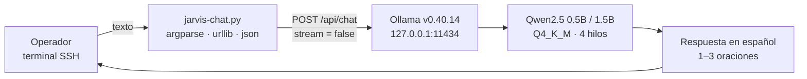
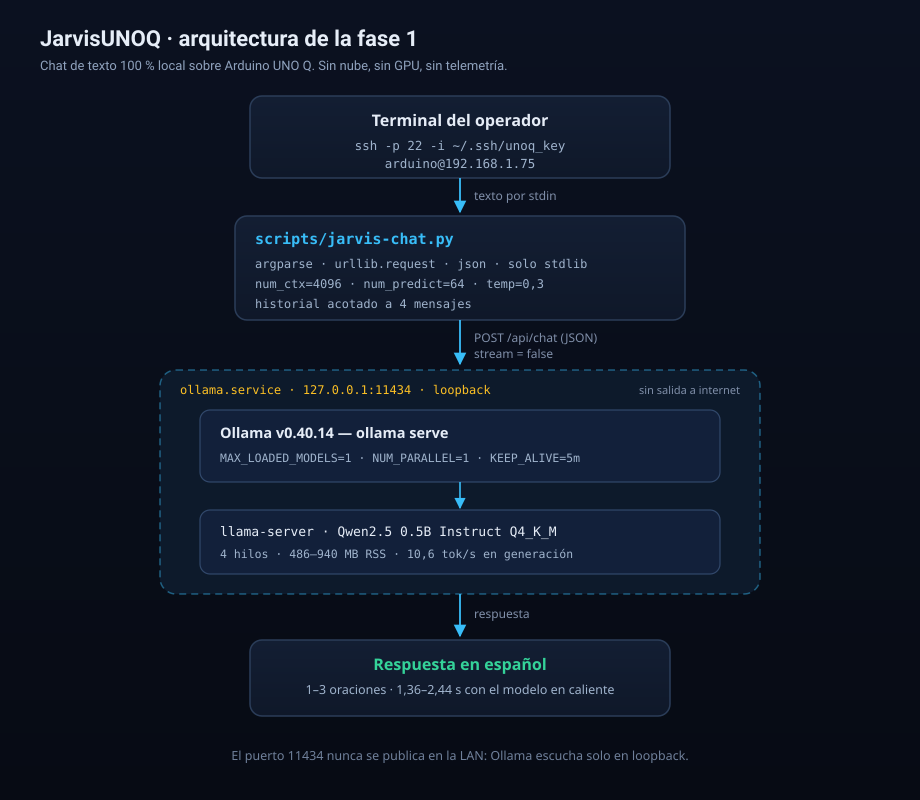
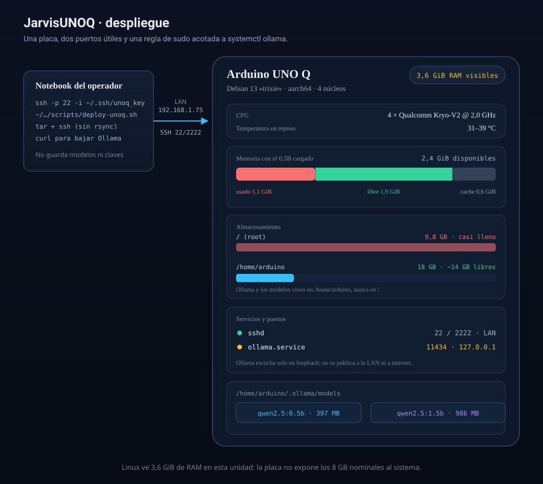
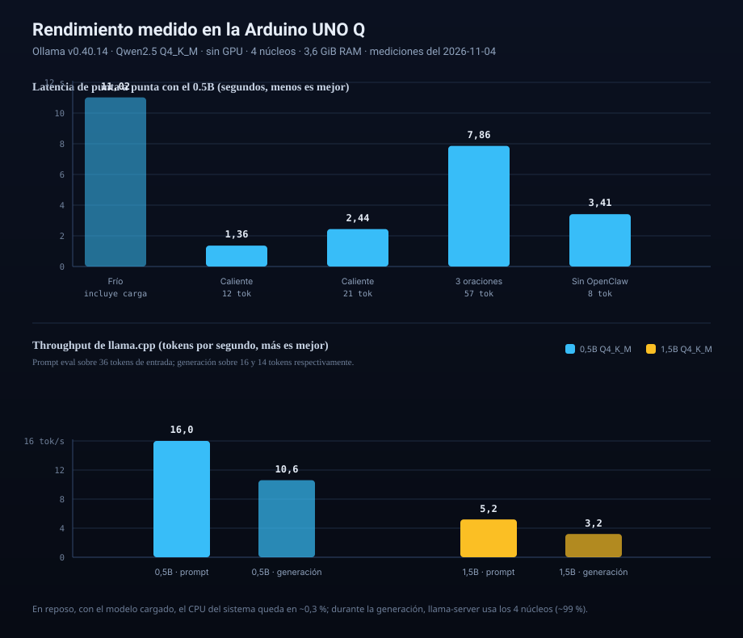

<div align="center">

# JarvisUNOQ

### Un asistente conversacional que vive en una Arduino UNO Q

**100 % local · sin GPU · sin nube · sin telemetría**

[](https://www.debian.org/releases/trixie/)
[](https://docs.arduino.cc/hardware/uno-q)
[](https://ollama.com)
[](https://github.com/QwenLM/Qwen2.5)
[](docs/PERFORMANCE.md)
[](LICENSE)

</div>

---

JarvisUNOQ es la fase inicial de un **Jarvis para el auto**: un asistente que
escucha, entiende y responde sin depender de una conexión a internet. Esta
primera entrega resuelve la parte más ingrata y más importante: **demostrar que
un modelo de lenguaje puede correr con latencia usable en una placa de 3,6 GiB
de RAM y cuatro núcleos, sin GPU y sin aceleradores**.

El resultado es un chat de texto que responde en **1,4 a 2,4 segundos** en
caliente, con todo el recorrido dentro de la Arduino UNO Q: el operador escribe
por SSH, un script de Python envía la consulta a la API local de Ollama, el
modelo Qwen2.5 genera la respuesta y la terminal la muestra. Nada sale de la
placa.

> **Nota de honestidad:** la UNO Q no es una placa de inferencia. Es un
> gateway y un nodo de sensores excelente. Este proyecto explora hasta dónde se
> puede llegar con lo que hay, mide el resultado y documenta los límites sin
> maquillarlos. Las cifras de este README son mediciones reales, no estimaciones
> de folleto.

---

## Tabla de contenidos

- [Qué es](#qué-es-jarvisunoq) · [Estado](#estado-actual) · [Arquitectura](#arquitectura)
- [Una consulta](#cómo-funciona-una-consulta) · [Cómo se construyó](#cómo-se-construyó)
- [Hardware](#hardware-y-software) · [Pinout](#conexiones-y-pinout) · [Requisitos](#requisitos)
- [Instalación](#instalación) · [Operación](#operación) · [Configuración](#configuración)
- [API local](#api-local) · [Despliegue](#despliegue-por-ssh) · [Rendimiento](#rendimiento-medido)
- [Limitaciones](#limitaciones-honestas) · [Roadmap](#roadmap) · [Seguridad](#seguridad-y-privacidad)
- [Estructura](#estructura-del-repositorio) · [Problemas](#solución-de-problemas)
- [Referencias](#referencias) · [Licencia](#licencia) · [Autor](#autor)

---

## Qué es JarvisUNOQ

JarvisUNOQ nació de una pregunta concreta: **¿cuánto de un asistente tipo
Jarvis se puede tener dentro de un auto sin depender de la nube?** La respuesta
corta es: la conversación, sí; la voz y la integración con el vehículo, todavía
no.

El proyecto se plantea como una escalera de fases:

| Fase | Alcance | Estado |
|---|---|---|
| **1. Texto** | Chat local por terminal contra un LLM en la placa | **Implementada y medida** |
| 2. Voz | Micrófono, STT local, TTS local, conversación hablada | Diseñada, no implementada |
| 3. Vehículo | Sensores, bus del auto, acciones sobre el entorno | Solo planteada |

Esta entrega cubre la fase 1 completa. El valor del repositorio no está en el
código —unos cientos de líneas de Python y Bash— sino en el **registro de qué
funciona, qué no y por qué**, incluido un intento fallido que se documenta sin
adornos: OpenClaw.

### Por qué existe

- **Privacidad:** un asistente de auto que manda audio y transcripciones a un
  servidor externo es un problema, no una característica.
- **Disponibilidad:** en la ruta o sin cobertura, un asistente cloud deja de
  existir; uno local sigue respondiendo.
- **Aprendizaje y anti-hype:** desplegar IA en 3,6 GiB enseña más sobre
  inferencia que veinte artículos sobre GPUs que no tenemos.

---

## Estado actual

| Ítem | Valor |
|---|---|
| Placa y sistema | Arduino UNO Q · Debian 13 «trixie» · aarch64 |
| RAM visible para Linux | **3,6 GiB** (la unidad no expone los 8 GB nominales) |
| CPU | 4 núcleos Qualcomm Kryo-V2, hasta 2,0 GHz |
| Almacenamiento útil | `/home/arduino`: 18 GB, ~14 GB libres |
| Motor de inferencia | Ollama **v0.40.14**, binario ARM64 sin CUDA |
| Modelo rápido | `qwen2.5:0.5b-instruct-q4_K_M` — 397 MB |
| Modelo de calidad | `qwen2.5:1.5b-instruct-q4_K_M` — 986 MB |
| Acceso | SSH a `192.168.1.75`, puerto 22 o 2222 |
| Latencia en caliente | **1,36 s** (12 tokens) a **2,44 s** (21 tokens) |

El chat funciona hoy. El arranque del servicio tarda segundos, no minutos. La
placa queda en ~1,1 GiB de RAM usada con el modelo de 0,5B cargado y ~2,4 GiB
disponibles para el resto del sistema.

---

## Arquitectura

El diseño es deliberadamente minimalista: **un cliente, un servidor, un
modelo**. No hay orquestador de agentes, no hay base vectorial, no hay bus de
mensajes. Cada pieza que se agregue después tendrá que justificar su RAM.





El detalle completo, con el presupuesto de memoria y las decisiones de diseño,
está en [`docs/ARCHITECTURE.md`](docs/ARCHITECTURE.md).

### Diagrama de despliegue

Todo el software vive en una sola placa. El notebook del operador es apenas un
terminal: no ejecuta modelos ni guarda estado del asistente.



---

## Cómo funciona una consulta

1. **El operador escribe** una consulta suelta o entra en `--interactive`. El
   texto viaja por SSH: la placa nunca abre un puerto de chat a la red.
2. **`jarvis-chat.py` arma el payload** con el system prompt, los últimos 4
   mensajes y `num_ctx=4096`, `num_predict=64`, `temperature=0.3`,
   `repeat_penalty=1.2`.
3. **POST a `/api/chat`**, la API nativa de Ollama, con `stream=false`. Ollama
   delega en `llama-server`, que carga el modelo si hace falta (3,9 s para el
   0.5B; 8,9 s para el 1.5B) y genera.
4. **La respuesta vuelve por el mismo socket.** El cliente imprime el texto; con
   `--stats` agrega tiempos y conteos de tokens.

El modelo **no ejecuta acciones**: el system prompt le prohíbe inventar
capacidades. Es un conversador, no un agente; actuar requeriría una capa de
herramientas que esta fase no tiene.

---

## Cómo se construyó

Esta sección registra las decisiones, los números que las sustentan y los
caminos abandonados. La bitácora cruda está en
[`docs/BITACORA.md`](docs/BITACORA.md).

### 1. Descubrimiento: la placa no es lo que dice la ficha

El 2026-11-03, lo primero fue medir:

- Linux reporta **3,6 GiB de RAM**, no los 8 GB nominales: todo el diseño parte
  de ese número.
- `/` tiene **9,8 GB y está casi llena**; `/home/arduino` tiene **18 GB con
  ~14 GB libres**. Por eso Ollama y los modelos viven ahí.
- No había Node, npm, pip ni Ollama; sí `curl`, `git`, `python3` y `zstd`, lo
  justo para instalar Ollama a mano. De ahí la estrategia: **binario, sin
  gestores de paquetes**, para no llenar la partición root.

### 2. OpenClaw: el intento que se descartó

Se instaló y se probó porque prometía un agente completo con herramientas. Los
números lo condenaron:

| Métrica | Valor | Consecuencia |
|---|---:|---|
| Gateway en reposo | **~1,2 GB RSS** (picos 1,4 GB) | Un tercio de la RAM |
| Tiempo hasta `/ready` | **~112 s** + ~39 s de mantenimiento | Arranque de **2m39s** |
| Prompt del agente | **~4.300–4.360 tokens** | >4 min por turno a ~5 tok/s |
| Timeout del cliente | 240 s | El turno no terminaba |
| Espacio recuperado | 852 MB + 332 MB | RAM y disco de vuelta |

Se probó `--local-model-lean`, `--cwd` vacío, `agent exec` y el 0,5B: también
superó los 200 s por turno. El cuello de botella era el **prompt eval** de un
prompt que no se podía recortar. `--isolated` falló con `Ollama requires
authentication` porque ignora la configuración del entorno.

Error instructivo: el primer `num_ctx=4096` con un prompt real de **12.463
tokens** devolvió HTTP 400. Subirlo a 12.288 lo hizo entrar, a un costo de
memoria y latencia injustificable.

**Decisión:** eliminar OpenClaw el 2026-11-04 —servicio detenido y borrado,
directorios eliminados— y dejar el sudoers en `systemctl start|stop|restart
ollama`. La lección: un framework de agentes es incompatible con cuatro núcleos
cuando se busca latencia conversacional, porque su valor —muchas herramientas,
contexto largo— es justo lo que esta placa no puede pagar.

### 3. Ollama sin CUDA: de 1,5 GB a 63 MB

El tar ARM64 incluye CUDA 12 y 13, inútil sin GPU NVIDIA. Se extrajo solo lo
necesario:

```bash
tar --zstd -xf ollama-linux-arm64.tar.zst -C /tmp/ollama-extract \
  --exclude='lib/ollama/cuda_v12' --exclude='lib/ollama/cuda_v13'
```

Resultado: **63 MB**. El SHA256 quedó registrado (`39bb333b…c94d0`) para
verificar la descarga. El binario vive en `/home/arduino/ollama`, enlazado en
`~/.local/bin`, y `ollama.service` fija `127.0.0.1:11434`, modelos en home y
contexto de 4096: sin ese ajuste, Ollama reserva 32.768 tokens y la memoria se
dispara.

### 4. Por qué Qwen2.5 0.5B y 1.5B

- **Tamaño:** 397 MB y 986 MB Q4_K_M entran con margen; un 7B ronda 4,4 GB y no
  cabe en 3,6 GiB.
- **Cuantización lista:** ambos existen como `Q4_K_M` en la biblioteca de
  Ollama, sin convertir pesos. Q4_K_M son ~4,8 bits efectivos por peso.
- **Español:** multilingüe razonable para su tamaño; el acento rioplatense se
  resuelve en parte con el system prompt.
- **Licencia:** Apache-2.0 en las model cards de 0.5B y 1.5B.
- **Escalera:** el mismo código sirve para ambos; se sube de calidad con una
  bandera.

**Lo que no se hizo:** no se comparó contra Llama 3.2, Gemma 2 ni Phi-3.5 en
esta placa. La elección se basó en tamaño, quant disponible y español, no en un
benchmark propio.

### 5. El compromiso RAM / latencia / calidad

| Modelo | RAM | Generación | Latencia | Cuándo |
|---|---:|---:|---:|---|
| 0.5B Q4_K_M | 486–940 MB | ~10,6 tok/s | 1,4–2,4 s caliente | Uso normal |
| 1.5B Q4_K_M | ~1,2 GB | ~3,2 tok/s | ~20 s en frío | Cuando importa la calidad |

El 0.5B es **~3× más rápido** y la brecha crece con prompts largos; a cambio
repite frases, pierde el hilo e inventa capacidades. El 1.5B es más coherente
pero convierte la charla en espera. Por defecto: 0.5B, `num_ctx=4096`,
`OLLAMA_MAX_LOADED_MODELS=1` y `OLLAMA_NUM_PARALLEL=1`. Los scripts de arranque
y parada se enlazan en el home como `~/start-jarvis.sh`.

---

## Hardware y software

| Componente | Detalle |
|---|---|
| Placa | Arduino UNO Q (Linux + microcontrolador en la misma placa) |
| SoC | Qualcomm, 4 núcleos Kryo-V2 hasta 2,0 GHz (medido: 2.016 MHz) |
| RAM y disco | 3,6 GiB visibles · `/` 9,8 GB · `/home/arduino` 18 GB |
| SO y base | Debian 13 «trixie» aarch64, `systemd`, `sshd`, `curl`, `git`, `python3`, `zstd` |
| Inferencia | Ollama v0.40.14, build ARM64 sin CUDA |
| Modelos | Qwen2.5 Instruct 0.5B y 1.5B, cuantizados Q4_K_M |
| Cliente | Python 3 con `argparse`, `json`, `urllib`, `time` (sin dependencias) |

No hay GPU, NPU utilizada ni acelerador externo: toda la inferencia es CPU con
las optimizaciones de `llama.cpp` que trae Ollama.

---

## Conexiones y pinout

Este proyecto es **software sobre Linux**: no consume GPIO, no cablea sensores y
no usa el microcontrolador de la placa. La tabla refleja las únicas conexiones
reales y las que la fase 2 necesitaría.

| Interfaz | Estado | Uso |
|---|---|---|
| USB-C de alimentación | **En uso** | Alimenta la placa (5 V) |
| USB-C de datos | Disponible | Consola serie; en modo dispositivo no sirve para micrófono |
| Wi-Fi / LAN | **En uso** | SSH a `192.168.1.75`, puertos 22 o 2222 |
| Header Arduino (GPIO) | **Sin uso** | Reservado para la fase 3 (sensores, relés) |
| Audio (micrófono y salida) | **No disponible** | Bloqueante para la fase 2 (ver [Roadmap](#roadmap)) |
| CAN del vehículo | No presente | Requiere hardware adicional |

> **Sobre el pinout:** no hay tabla de pines porque no hay pines conectados.
> Inventar un pinout para un proyecto que corre por SSH sería el tipo de dato
> falso que este repositorio evita.

---

## Requisitos

- **Placa:** Arduino UNO Q con Debian 13 aarch64 y SSH habilitado.
- **Alimentación:** USB-C estable; la inferencia mantiene los 4 núcleos al 100 %.
- **Red:** local entre el operador y la placa.
- **En la placa:** `systemd`, `curl`, `zstd`, `python3` (stdlib) y ~2 GB libres
  en `/home/arduino` para Ollama y los modelos.
- **En el operador:** `ssh` con clave ed25519, `bash`, `tar` y `curl`. No hace
  falta un host potente: el notebook solo abre la terminal.
- **sudo:** la regla acotada de [`config/sudoers-jarvis`](config/sudoers-jarvis).

### Dependencias Python

**Ninguna externa.** `jarvis-chat.py` y `measure-jarvis.py` usan solo la
biblioteca estándar (`argparse`, `json`, `os`, `subprocess`, `sys`, `time`,
`urllib`). No hay `requirements.txt` porque no hace falta: no se crea un venv ni
se instala nada con `pip`. Si se agregan dependencias en el futuro, el lugar
correcto es un `requirements.txt` en la raíz y un venv documentado acá.

---

## Instalación

La guía completa, con verificación de SHA256 y las decisiones para no llenar la
partición root, está en [`docs/INSTALL.md`](docs/INSTALL.md).

### 1. Acceso

```bash
ssh -p 22 -i ~/.ssh/unoq_key arduino@192.168.1.75
```

### 2. Ollama ARM64 sin CUDA

```bash
curl -fL \
  https://github.com/ollama/ollama/releases/download/v0.40.14/ollama-linux-arm64.tar.zst \
  -o ollama-linux-arm64.tar.zst

mkdir -p /tmp/ollama-extract
tar --zstd -xf ollama-linux-arm64.tar.zst -C /tmp/ollama-extract \
  --exclude='lib/ollama/cuda_v12' --exclude='lib/ollama/cuda_v13'

mkdir -p /home/arduino/ollama /home/arduino/.ollama/models /home/arduino/.local/bin
cp -r /tmp/ollama-extract/bin /tmp/ollama-extract/lib /home/arduino/ollama/
ln -sf /home/arduino/ollama/bin/ollama /home/arduino/.local/bin/ollama
/home/arduino/.local/bin/ollama --version
```

### 3. Servicio systemd

```bash
sudo cp config/ollama.service /etc/systemd/system/ollama.service
sudo systemctl daemon-reload
sudo systemctl enable --now ollama
curl -fsS http://127.0.0.1:11434/api/tags
```

### 4. Modelos

```bash
/home/arduino/.local/bin/ollama pull qwen2.5:0.5b-instruct-q4_K_M
/home/arduino/.local/bin/ollama pull qwen2.5:1.5b-instruct-q4_K_M
```

### 5. Sudoers acotado

```bash
sudo cp config/sudoers-jarvis /etc/sudoers.d/90-jarvis-control
sudo chmod 0440 /etc/sudoers.d/90-jarvis-control
sudo visudo -cf /etc/sudoers.d/90-jarvis-control
```

### 6. Proyecto y prueba

```bash
./scripts/deploy-unoq.sh          # desde el host
ssh -p 22 -i ~/.ssh/unoq_key arduino@192.168.1.75
~/start-jarvis.sh
~/jarvis-chat "Hola Jarvis, presentate en una frase"
```

---

## Operación

### Arrancar

```bash
~/start-jarvis.sh
```

Inicia `ollama.service` vía `sudo -n systemctl start ollama`, espera hasta 60 s
a que `/api/tags` responda y muestra el estado. Si el sudoers no está instalado,
falla con un mensaje explícito en lugar de pedir contraseña.

### Ver estado

```bash
~/status-jarvis.sh
```

Muestra, en este orden: estado del servicio, socket en escucha, modelos
cargados (`ollama ps`), modelos instalados (`ollama list`), CPU y RSS por
proceso (`measure-jarvis.py`) y espacio libre en `/home/arduino`.

### Chatear

```bash
~/jarvis-chat "¿Qué podés hacer como asistente en el auto?"
~/jarvis-chat --interactive
~/jarvis-chat --stats "Responde exactamente: hola"
~/jarvis-chat --model qwen2.5:1.5b-instruct-q4_K_M --interactive
```

En modo interactivo, `salir`, `exit`, `quit`, `Ctrl-C` y `Ctrl-D` terminan la
sesión. No hay demonio de chat: el cliente existe solo mientras dura la
conversación.

### Detener

```bash
~/stop-jarvis.sh
```

Descarga ambos modelos (`ollama stop`), detiene el servicio y espera a que el
puerto 11434 se cierre. Con Ollama detenido, la placa no consume CPU ni RAM por
este proyecto.

---

## Configuración

### Variables de entorno del cliente

| Variable | Default | Efecto |
|---|---|---|
| `JARVIS_MODEL` | `qwen2.5:0.5b-instruct-q4_K_M` | Modelo por defecto |
| `OLLAMA_HOST` | `127.0.0.1:11434` | Host de la API |

### Banderas de `jarvis-chat.py`

| Bandera | Default | Descripción |
|---|---|---|
| `prompt` (posicional) | — | Consulta de una sola vez |
| `-i`, `--interactive` | off | Modo conversación |
| `--model` | 0.5B | Modelo de Ollama |
| `--host` | `127.0.0.1:11434` | Host de Ollama |
| `--max-tokens` | 64 | `num_predict` |
| `--temperature` | 0.3 | Creatividad |
| `--repeat-penalty` | 1.2 | Penalización de repetición |
| `--num-ctx` | 4096 | Ventana de contexto |
| `--history` | 4 | Mensajes de historial conservados |
| `--stats` | off | Muestra tiempos y tokens |

### Variables de `ollama.service`

| Variable | Valor | Motivo |
|---|---|---|
| `OLLAMA_MODELS` | `/home/arduino/.ollama/models` | Sacar los modelos de `/` |
| `OLLAMA_HOST` | `127.0.0.1:11434` | Loopback only |
| `OLLAMA_MAX_LOADED_MODELS` | `1` | Evitar 0.5B + 1.5B en RAM |
| `OLLAMA_NUM_PARALLEL` | `1` | Un pedido a la vez |
| `OLLAMA_KEEP_ALIVE` | `5m` | Liberar RAM tras 5 min de inactividad |
| `OLLAMA_CONTEXT_LENGTH` | `4096` | No reservar 32k por defecto |
| `OLLAMA_NUM_THREADS` | `4` | Usar los cuatro núcleos |

### Calibración

No hay calibración de hardware. El único ajuste fino es de inferencia:
`temperature` (0.3), `repeat_penalty` (1.2), `num_ctx` (4096) y `num_predict`
(64). Subir la temperatura da más variedad y más alucinación; bajarla la reduce.

### Variables de despliegue

`UNOQ_HOST` (default `192.168.1.75`), `UNOQ_USER` (`arduino`), `UNOQ_PORT`
(`22`) y `UNOQ_KEY` (`~/.ssh/unoq_key`) parametrizan `deploy-unoq.sh`.

---

## API local

Ollama expone una API HTTP en `127.0.0.1:11434`. Estos son los endpoints que
usa el proyecto y los que sirven para depurar.

```bash
# Modelos instalados y cargados en memoria
curl -fsS http://127.0.0.1:11434/api/tags | python3 -m json.tool
curl -fsS http://127.0.0.1:11434/api/ps   | python3 -m json.tool

# Chat sin streaming (lo que hace jarvis-chat.py)
curl -fsS http://127.0.0.1:11434/api/chat \
  -H 'Content-Type: application/json' \
  -d '{"model":"qwen2.5:0.5b-instruct-q4_K_M","stream":false,
       "messages":[{"role":"system","content":"Respondé breve y en español."},
                   {"role":"user","content":"Decime hola"}],
       "options":{"num_ctx":4096,"num_predict":32}}' | python3 -m json.tool
```

La respuesta de `/api/chat` incluye `message.content` y las métricas
`total_duration`, `load_duration`, `prompt_eval_count`, `prompt_eval_duration`,
`eval_count` y `eval_duration` (en nanosegundos). `--stats` las formatea. El
endpoint compatible con OpenAI existe, pero no se usa: la API nativa devuelve
métricas más útiles y menos capas.

---

## Despliegue por SSH

`scripts/deploy-unoq.sh` empaqueta el proyecto con `tar`, lo envía por `ssh` y
crea los enlaces en el home de la placa. No usa `rsync` ni requiere agentes.
Crea `/home/arduino/JarvisUNOQ` de forma idempotente, excluye `.git`,
`__pycache__`, `*.pyc`, `*.log` y `.env`, da permisos de ejecución y enlaza
`~/start-jarvis.sh`, `~/stop-jarvis.sh`, `~/status-jarvis.sh` y `~/jarvis-chat`.

```bash
./scripts/deploy-unoq.sh
# Personalizado:
UNOQ_HOST=192.168.1.75 UNOQ_PORT=2222 UNOQ_KEY=~/.ssh/otra_key ./scripts/deploy-unoq.sh
```

Después del despliegue, el ciclo es siempre el mismo: `start`, `chat`, `stop`.

---

## Rendimiento medido

Todas las cifras provienen de [`docs/PERFORMANCE.md`](docs/PERFORMANCE.md),
medidas el **2026-11-04** en la placa, por SSH, sin GPU y sin otros proyectos
corriendo. No hay números estimados ni extrapolados.



### Latencia del chat real

| Prueba | Total | Prompt eval | Generación | Tokens |
|---|---:|---:|---:|---:|
| Saludo en frío (modelo sin cargar) | **11,02 s** | 93 tok / 5,90 s | 19 tok / 1,86 s | 19 |
| Saludo inmediato en caliente | **1,36 s** | 93 tok / 0,13 s | 12 tok / 1,15 s | 12 |
| Otra respuesta corta en caliente | **2,44 s** | 80 tok / 0,11 s | 21 tok / 2,25 s | 21 |
| Respuesta de tres oraciones | **7,86 s** | 87 tok / 2,15 s | 57 tok / 5,69 s | 57 |
| Tras eliminar OpenClaw | **3,41 s** | 91 tok / 2,68 s | 8 tok / 0,71 s | 8 |

La diferencia entre 1,36 s y 2,44 s no es ruido: depende de cuántos tokens
genera la respuesta. **Para conversación corta, el orden de magnitud es 1–4 s en
caliente.**

### Benchmarks crudos de Ollama

Prompt de prueba: `"Responde exactamente: hola"` (36 tokens de entrada).

| Modelo | Carga | Prompt eval | Generación | Total | RSS |
|---|---:|---:|---:|---:|---:|
| `qwen2.5:0.5b-instruct-q4_K_M` | 3,89 s | 2,25 s (36 tok, ~16 tok/s) | 16 tok en 1,50 s (~10,6 tok/s) | **7,77 s** | 940 MB con ctx 32768 |
| `qwen2.5:1.5b-instruct-q4_K_M` | 8,9 s | 6,96 s (36 tok, ~5,2 tok/s) | 14 tok en 4,42 s (~3,2 tok/s) | **20,3 s** | 1,2 GB |

### Memoria y CPU

```text
MemTotal:       3,6 GiB
Mem usado:      1,1 GiB
Mem libre:      1,9 GiB
Mem disponible: 2,4 GiB
Modelo 0.5B:    486 MB
Proceso ollama: ~40 MB
Swap:           ~158 MiB
CPU:            4 núcleos a 2.016 MHz
Temperatura:    31–39 °C
```

En reposo, con el modelo cargado, el CPU del sistema queda en **~0,3 %**.
Durante la generación, `llama-server` usa los 4 núcleos y el sistema llega a
**~99 %**. El 1.5B agrega ~1,2 GB cuando se carga, por eso
`OLLAMA_MAX_LOADED_MODELS=1` no es opcional.

### Cómo reproducir estas cifras

```bash
~/start-jarvis.sh && ~/jarvis-chat --stats "Responde exactamente: hola"
~/jarvis-chat --stats --model qwen2.5:1.5b-instruct-q4_K_M "Responde exactamente: hola"
```

### Lectura de los números

- **El cuello de botella es el prompt eval.** Un prompt de sistema de 90 tokens
  cuesta 2,15 s; uno de 4.300 tokens, minutos. Esa es la razón exacta por la que
  OpenClaw no era viable.
- **La primera consulta paga la carga del modelo** (3,9 s para 0.5B). Después,
  el chat es conversacional.
- **El contexto importa:** bajar de 32.768 a 4.096 tokens libera memoria y
  acelera el prompt eval.

---

## Limitaciones honestas

Este es un prototipo de exploración, no un producto. Lo que **no** hace:

1. **Solo texto.** No hay micrófono, STT ni TTS. La conversación hablada es
   fase 2 y todavía no está implementada.
2. **Los modelos son chicos.** El 0.5B repite frases, pierde el hilo en
   conversaciones largas y su razonamiento numérico es flojo. El 1.5B mejora,
   pero a 3,2 tok/s.
3. **Alucina capacidades y no tiene herramientas.** Si se le pregunta si puede
   leer archivos o apagar luces, a veces dice que sí. No hay function calling,
   RAG, sensores ni comandos: el system prompt lo aclara, pero no lo garantiza.
4. **No hay GPU ni NPU en uso.** El techo de velocidad lo ponen los 4 núcleos.
5. **Un cliente a la vez y contexto de 4096 tokens.** Dos usuarios simultáneos
   no están soportados, y el contexto alcanza para un ida y vuelta corto, no
   para pegar un documento.
6. **Sin persistencia.** Al cerrar el cliente se pierde el historial; no hay
   memoria entre sesiones.
7. **3,6 GiB, no 8 GB.** Cualquier comparación con placas de 8 GB es inválida.
8. **El audio está bloqueado por hardware.** El único USB-C está en modo
   dispositivo, así que un micrófono USB directo no es una solución obvia; hace
   falta un hub con PD o alimentar por VIN y usar host mode.

---

## Roadmap

### Fase 2: voz

```text
Micrófono → STT (whisper.cpp / Vosk) → Ollama → TTS (Piper) → parlante
```

- **STT:** `whisper.cpp` con modelo `tiny` o `base` en español, o Vosk chico.
- **TTS:** Piper con voz en español; liviano y rápido en CPU.
- **Serializar:** no mantener STT, LLM y TTS en RAM a la vez; con 3,6 GiB la
  suma entra en swap.
- **Activación:** botón físico o tecla al principio; wake word después.
- **Latencia objetivo:** STT 1–3 s + LLM 2–5 s + TTS 1–2 s, menos de 10 s por
  turno.
- **Bloqueante:** la captura de audio. El USB-C en modo dispositivo no da
  entrada de micrófono útil.

### Fase 3: vehículo

- **CAN:** requiere hardware adicional (controlador y transceptor). No está
  implementado ni probado en esta placa.
- **Sensores:** GPIO del header Arduino para temperatura, presencia o relés.
- **Acciones:** capa de herramientas con permisos explícitos, para que el modelo
  proponga sin ejecutar a ciegas.

### Mejoras transversales

- Comparar Qwen2.5 contra Llama 3.2 1B y Gemma 2 2B en esta placa.
- Evaluar `qwen2.5:3b` con contexto 2048 y latencia alta.
- Persistencia opcional de historial en SQLite.
- Cliente como unidad `systemd` de usuario para consola dedicada.
- Medir consumo eléctrico, que acá no se midió.

---

## Seguridad y privacidad

| Control | Implementación |
|---|---|
| Exposición de red | Ollama escucha **solo** en `127.0.0.1:11434` |
| Superficie de ataque | SSH es el único servicio accesible desde la LAN |
| Autenticación | Clave ed25519; sin contraseñas en el repositorio |
| Privilegios | `sudoers` limitado a `systemctl start\|stop\|restart ollama` |
| Root por SSH | No habilitado |
| Telemetría y secretos | Ninguna salida a terceros; sin tokens ni claves de API |

**Modelo de amenaza:** quien tenga acceso SSH al usuario `arduino` puede
conversar y detener el servicio, pero no escalar a root por el sudoers: la regla
nombra un único comando y un único servicio. La API de Ollama no tiene
autenticación propia; su protección es el bind a loopback, así que **no hay que
publicarla en la LAN** con `OLLAMA_HOST=0.0.0.0`.

**Privacidad:** las conversaciones no salen de la placa. El modelo no accede a
archivos ni a la red, y el system prompt se lo recuerda en cada turno.

---

## Estructura del repositorio

```text
JarvisUNOQ/
├── README.md · LICENSE (MIT)
├── config/
│   ├── ollama.service     Unidad systemd (loopback, 4096 ctx, 4 hilos)
│   └── sudoers-jarvis     Regla acotada para systemctl ollama
├── scripts/
│   ├── start-jarvis.sh    Inicia Ollama y espera la API
│   ├── stop-jarvis.sh     Descarga modelos y detiene el servicio
│   ├── status-jarvis.sh   Servicio, puerto, modelos, CPU/RAM, disco
│   ├── jarvis-chat.py     Cliente de chat (stdlib)
│   ├── measure-jarvis.py  Muestreo de CPU y RSS por proceso
│   └── deploy-unoq.sh     Copia el proyecto a la placa por SSH
└── docs/
    ├── INSTALL · ARCHITECTURE · PERFORMANCE · BITACORA
    ├── datasheet · developer · REFERENCES
    └── assets/            SVG de arquitectura, despliegue y rendimiento
```

---

## Solución de problemas

| Síntoma | Causa probable | Solución |
|---|---|---|
| `No se pudo conectar con Ollama` | Servicio detenido | `~/start-jarvis.sh` o `systemctl status ollama` |
| `sudo: a password is required` | Falta la regla de sudoers | Instalar `config/sudoers-jarvis` y validar con `visudo -cf` |
| `ollama: command not found` | `~/.local/bin` fuera del PATH | Usar ruta completa o exportar el PATH |
| `model not found` | Modelo no descargado | `ollama pull qwen2.5:0.5b-instruct-q4_K_M` |
| Respuestas repetidas | Limitación del 0.5B | Subir `--repeat-penalty`, reformular o usar el 1.5B |
| La placa se pone lenta | 1.5B + contexto grande + otro proceso | Volver al 0.5B, `num_ctx=4096`, un cliente a la vez |
| Disco root lleno | Se instaló en `/usr` o `/tmp` | Mover Ollama y modelos a `/home/arduino` |
| `start-jarvis.sh` agota 60 s | Servicio en bucle de reinicio | `journalctl -u ollama -n 80 --no-pager` |
| Swap creciendo | Dos modelos cargados | Verificar `OLLAMA_MAX_LOADED_MODELS=1` y `ollama ps` |

Diagnóstico en una línea:

```bash
systemctl is-active ollama; ss -ltn | grep ':11434'; \
curl -fsS http://127.0.0.1:11434/api/tags; ~/jarvis-chat --stats "Decime hola"
```

---

## Referencias

| Recurso | Para qué sirve |
|---|---|
| [ollama.com](https://ollama.com) | Sitio oficial y biblioteca de modelos |
| [github.com/ollama/ollama](https://github.com/ollama/ollama) | Código, API y releases del motor |
| [Qwen2.5 (GitHub)](https://github.com/QwenLM/Qwen2.5) | Familia de modelos y reporte técnico |
| [Qwen2.5-0.5B-Instruct](https://huggingface.co/Qwen/Qwen2.5-0.5B-Instruct) | Model card y licencia del modelo rápido |
| [Qwen2.5-1.5B-Instruct](https://huggingface.co/Qwen/Qwen2.5-1.5B-Instruct) | Model card y licencia del modelo de calidad |
| [llama.cpp](https://github.com/ggml-org/llama.cpp) | Motor de inferencia en CPU que usa Ollama |
| [Especificación GGUF](https://github.com/ggml-org/ggml/blob/master/docs/gguf.md) | Formato de los modelos cuantizados |
| [Arduino UNO Q](https://docs.arduino.cc/hardware/uno-q) | Documentación oficial de la placa |
| [Debian 13 «trixie»](https://www.debian.org/releases/trixie/) | Sistema operativo de la placa |
| [systemd.service](https://www.freedesktop.org/software/systemd/man/latest/systemd.service.html) | Sintaxis de la unidad de Ollama |

La lista comentada, con el motivo de cada enlace, está en
[`docs/REFERENCES.md`](docs/REFERENCES.md).

---

## Licencia

Código bajo **MIT** (ver [`LICENSE`](LICENSE)). Ollama, Qwen2.5, Debian y Arduino
conservan sus licencias: Qwen2.5 0.5B y 1.5B son Apache-2.0 según sus model
cards; Ollama es MIT.

## Autor

**wanderc137** — exploración personal de IA local en hardware embebido.
[github.com/wanderc137/JarvisUNOQ](https://github.com/wanderc137/JarvisUNOQ)

> Si vas a replicar esto: medí antes de optimizar y no instales nada en la
> partición root. La UNO Q perdona el entusiasmo, no el `pip install` en `/`.
